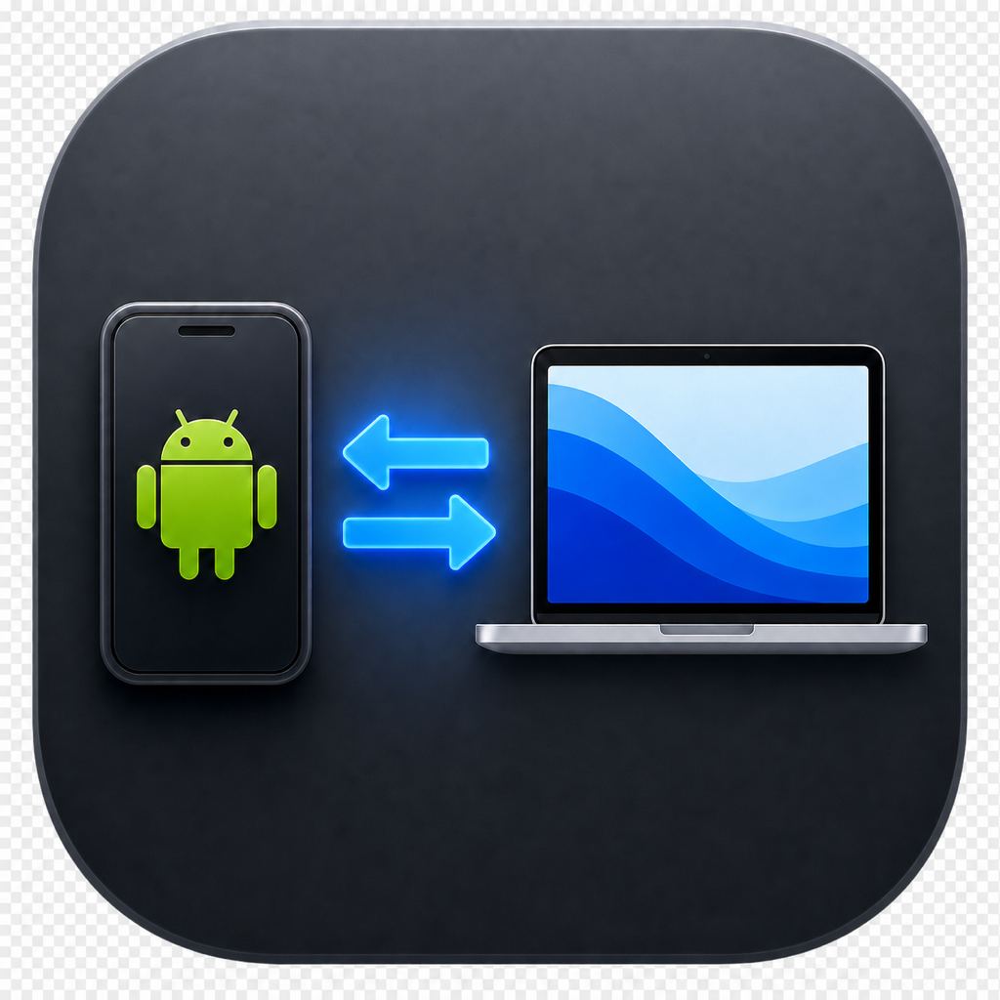
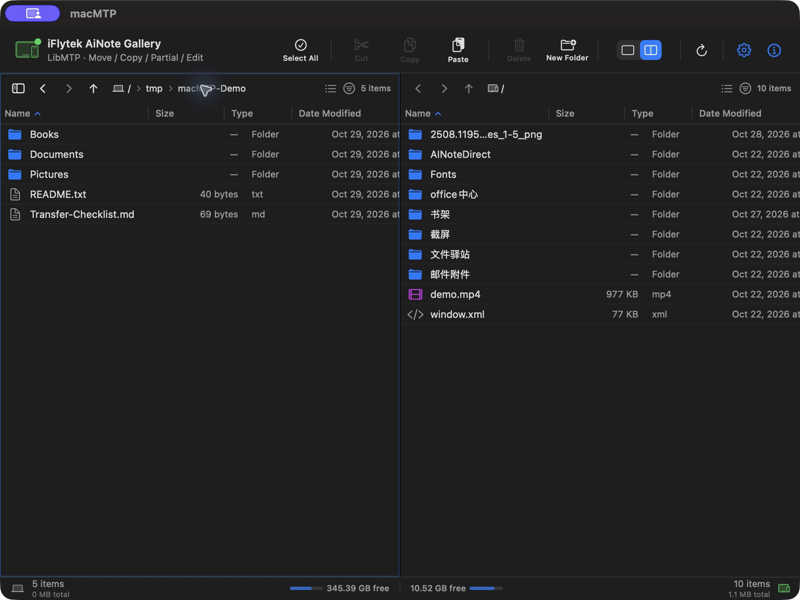
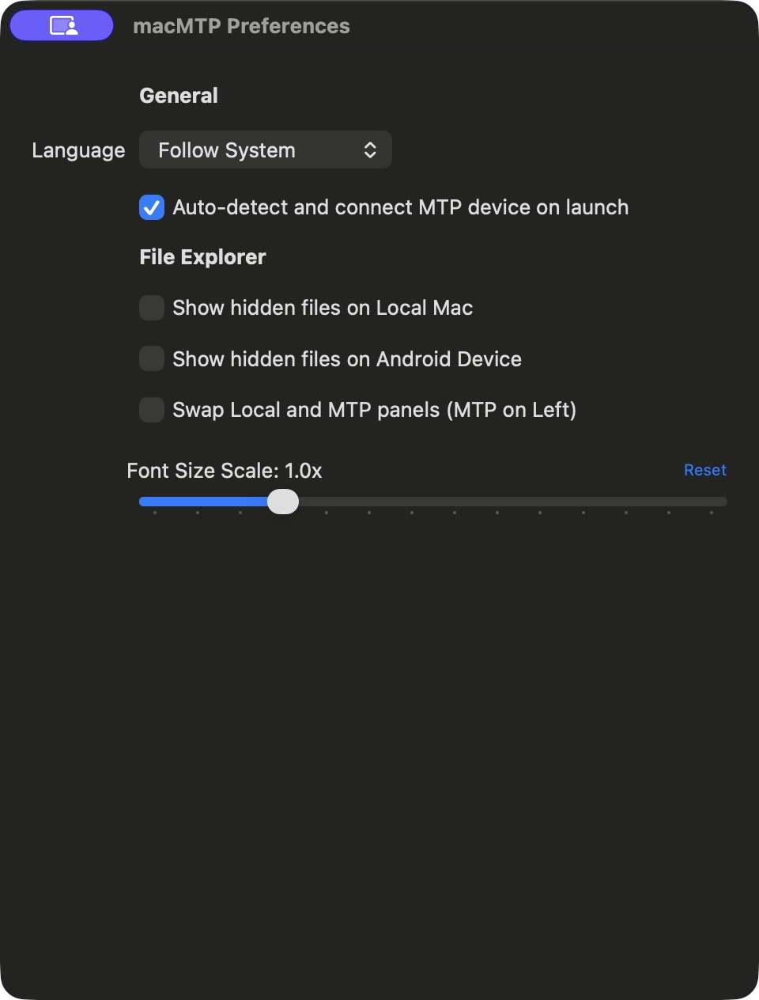
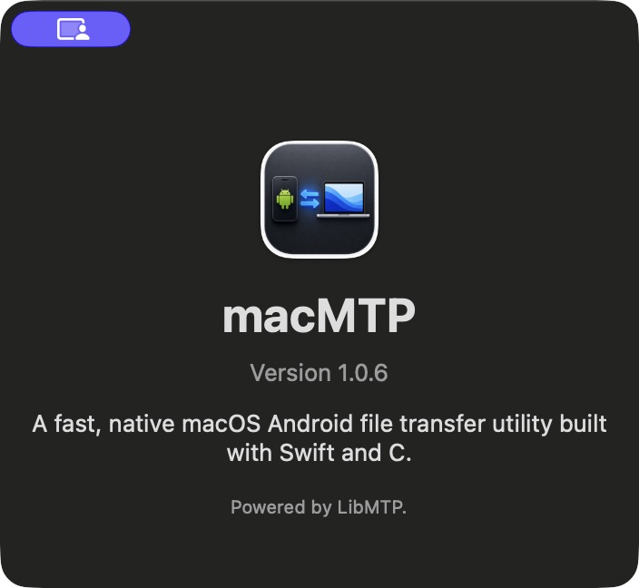
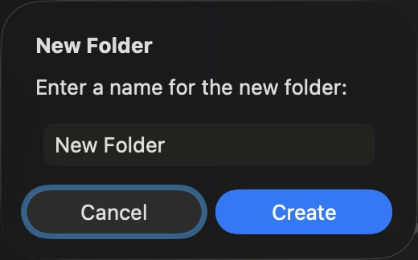

# macMTP

[English](README.md) · [简体中文](README.zh-CN.md)

<p align="center"></p>

通过 USB 在 Mac 与 Android/MTP 设备之间传输文件的原生 macOS 文件管理工具。界面使用 SwiftUI、AppKit，MTP 层通过 C bridge 调用 LibMTP，无需 Go 工具链或 OpenMTP 源码。

## 界面截图

以下为 2026-10-29 在 macOS 上实拍的 1.0.6 界面。主窗口截图已使用临时演示目录重新拍摄，设备处于连接状态，不显示个人主目录路径。

<p align="center"></p>

| 偏好设置 | 关于 |
| --- | --- |
|  |  |

<details>
<summary>新建文件夹对话框</summary>


</details>

截图清单与拍摄说明见 [assets/screenshots](assets/screenshots/README.md)。

## 主要功能

- 检测 USB MTP 设备并自动连接；设备提供多个存储时可切换存储。
- 本地与设备双栏浏览，以及仅显示设备的单栏布局；支持列表/图标视图、筛选、排序、隐藏文件、面包屑导航及本地侧边栏。
- 批量上传、下载文件与目录树，包含空目录；支持多文件拖入应用，以及面板间复制、剪切、粘贴。
- 传输队列支持进度、取消和队列操作之间的暂停/继续；暂停不是正在传输文件的字节级断点续传。
- 同名冲突支持覆盖、跳过或按大小判断；大小相同不代表内容相同。
- 剪切仅在某个选择下的全部队列项成功后清理对应源；含跳过或失败项的目录树保留。源文件缺失及传输失败会在应用内提示。
- 新建文件夹、重命名和删除。本地删除进入废纸篓；设备端删除没有应用内恢复入口。
- 设备声明支持 `CopyObject`/`MoveObject` 时，可在设备内部复制/移动；设备不提供字节级进度，因此显示不确定进度。
- 中英文界面、左右面板交换及字体缩放设置。

不同设备的能力有所差异。设备可能拒绝特殊文件名；上传后预期名称或大小不匹配时不会标记成功。设备文件直接拖到 Finder、热拔插及完整设备兼容矩阵仍需补测，详见[测试报告](docs/test-reports/README.md)。

## 环境要求

- 最低部署目标为 macOS 14.0。本轮本地构建验证环境为 Apple Silicon/macOS 26.6.2，尚未在 macOS 14 或 Intel 实机上验证运行。
- 支持 MTP 的 Android 或其他设备、可传输数据的 USB 线；设备开启“文件传输 / MTP”模式。
- 开发环境需要带 Swift 6.0+ 和 macOS SDK 的 Xcode，以及 `pkg-config`、`make`、`curl`、`tar`、`shasum`。

## 构建与启动

在项目根目录执行：

```bash
brew install pkg-config
./scripts/download.sh
bash scripts/build.sh release --arch "$(uname -m)"
open macMTP.app
```

构建脚本会在缺失时将运行库编译到 `thirdparty/runtime/<arch>-macos14`，随后构建、打包并临时签名 `macMTP.app`，不修改 Homebrew 中的库。依赖使用固定版本源码，下载后核对 SHA-256：

| 运行库 | 版本 |
| --- | --- |
| libmtp | 1.1.23 |
| libusb | 1.0.29 |
| libgcrypt | 1.11.2 |
| libgpg-error | 1.58 |

打包时检查所有运行库的架构和最低系统版本，要求最低版本不高于 14.0。libgpg-error 禁用 NLS，因此不需要 gettext/libintl 运行库；应用本身仍支持中英文。

开发及打包命令：

```bash
bash scripts/build.sh debug --arch "$(uname -m)"
# 兼容旧打包入口，同时复制到 .build/macMTP.app
bash scripts/package.sh --arch "$(uname -m)"
# 在 release/ 生成 DMG、ZIP 和校验文件，会替换该目录原有内容
bash scripts/release.sh 1.0.6 --arch "$(uname -m)"
```

使用 `MACMTP_RUNTIME_PREFIX` 指定兼容的预构建依赖目录；高级覆盖项包括 `MACMTP_LIBMTP_ROOT`、`MACMTP_LIBMTP_LIB_DIR` 和 `MACMTP_LIBUSB_LIB_DIR`。

详细下载、SHA-256 校验、独立编译及源码集成步骤见 [LibMTP 构建指南](docs/development/LIBMTP_BUILD.md)，4 个依赖统一放在 [thirdparty](thirdparty/README.md)，源码及编译产物由 Git 忽略，运行 `./scripts/download.sh` 即可恢复固定版本源码。

### Intel 与 Universal 构建

```bash
bash scripts/build.sh release --arch x86_64
```

Apple Silicon 上的 Xcode 支持 x86_64 交叉编译，但依赖也必须为 x86_64。脚本具备按架构编译依赖的路径，本轮尚未实际验证这条完整构建流程。目前已验证的本地应用仅包含 **arm64**。

`--universal` 要求所有运行库同时包含兼容的 arm64 与 x86_64 切片，不会自动合并两个独立依赖目录。当前 CI 的构建、测试及标签发布仅面向 runner 本机架构，不生成 Universal 发布包。

## 测试

```bash
# 新拉取项目后，直接使用 SwiftPM 前先构建运行库
bash scripts/build-runtime.sh "$(uname -m)"
swift test

# 关闭 macMTP，连接空闲测试设备后显式启用真机测试
MACMTP_RUN_DEVICE_TESTS=1 swift test --filter FileTransferDeviceRegressionTests
```

真机测试创建并清理独立 UUID 测试目录，默认测试套件会跳过。组件清理后，`swift test` 发现 38 项：**37 项通过、1 项跳过、0 失败**。之前的八项缺陷修复另有 11 个真机检查点通过，本次清理没有重新执行这些真机检查。

详见[测试用例](docs/testing/TEST_CASES.md)、[测试报告](docs/test-reports/README.md)和[本次清理记录](docs/maintenance/2026-10-29-project-refresh.md)。CI 会正常返回测试失败，不再将失败转换为“未发现测试”。

## 排查与隐私

1. 解锁设备、启用 MTP 模式，尝试其他数据线或接口。
2. 关闭其他可能占用 USB 接口的 MTP 客户端，再重连或刷新。
3. 传输失败时查看应用内错误，核对目标结果前保留源文件。

当前不包含遥测 SDK、崩溃报告上传或自动更新服务，已删除无实际作用的上报开关与授权弹窗。诊断信息仅写入本地 `/tmp/macmtp-debug.log`，可能包含文件名、路径和设备错误；提交问题时请先检查日志内容。

## 项目结构

```text
Sources/
├── CLibMTPBridge/    # LibMTP C ABI、USB 操作与回调
└── macmtp/          # SwiftUI/AppKit 界面、设备 actor、模型与服务
Tests/macmtpTests/   # 单元测试、传输回归及可选真机测试
Resources/          # 应用配置、图标和中英文资源
assets/             # README 图标及当前界面截图
docs/               # 产品、架构、测试、报告与历史归档
thirdparty/         # 依赖清单；忽略下载包、源码及运行库
scripts/            # 运行库编译、应用构建及打包
```

响应模型中的 `Go*` 是 LibMTP bridge 仍在使用的历史 ABI/JSON 兼容命名，不代表保留 Go 后端。CKalam、未使用的静态库、SentryStub 和空实现更新服务均已移除。

## 文档与贡献

- [文档总索引](docs/README.md)
- [产品需求](docs/product/PRD.md) · [技术架构](docs/architecture/TECHNICAL_ARCHITECTURE.md)
- [贡献指南](CONTRIBUTING.md) · [行为准则](CODE_OF_CONDUCT.md)
- [安全政策](SECURITY.md) · [治理规则](GOVERNANCE.md) · [维护者](MAINTAINERS.md)

感谢 [LibMTP](https://libmtp.sourceforge.net/) 和 [libusb](https://libusb.info/)。macMTP 使用 [MIT 许可证](LICENSE)，随包运行库保留各自许可证。

## 开源协议

macMTP 自有代码使用 [MIT 协议](LICENSE)。LibMTP、libusb、libgcrypt 和 libgpg-error 保留各自许可，详见[第三方开源声明](THIRD_PARTY_NOTICES.md)及[许可证原文](LICENSES/README.md)。应用构建会将声明和原文复制到 `Contents/Resources/Licenses/`；此前已生成的 DMG 保持不变。

开源源码发布见[发布准备指南](docs/development/OPEN_SOURCE_RELEASE.md)。运行 `python3 scripts/check-publication.py` 检查，增加 `--export .build/macMTP-source-release.tar.gz` 可导出不含 Git 历史及本机忽略文件的源码快照。
