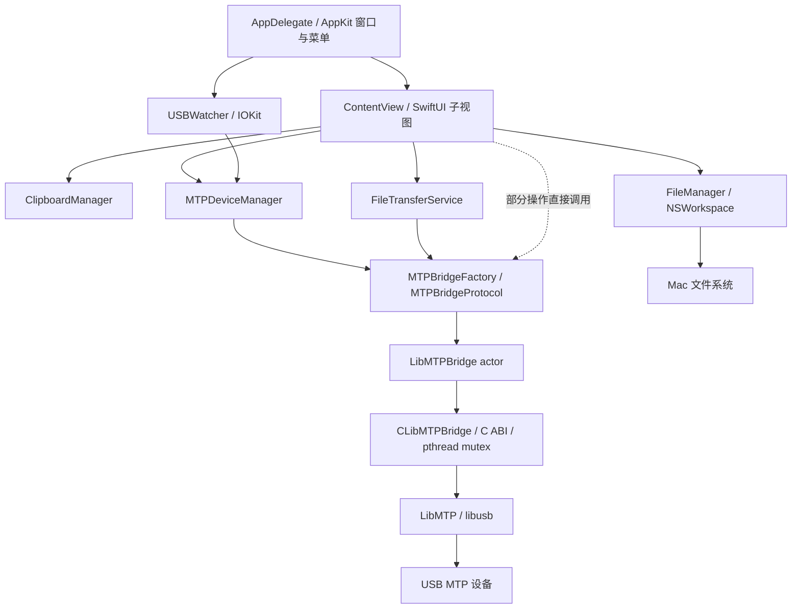
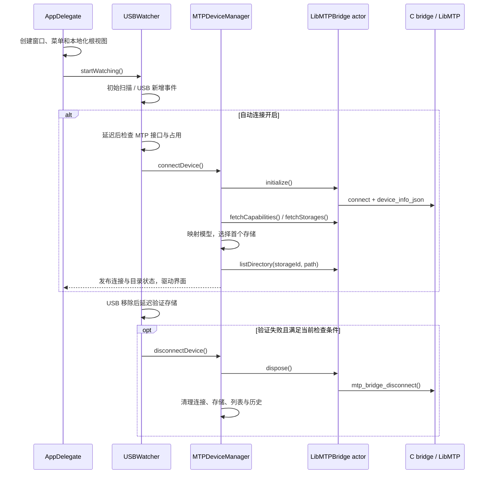
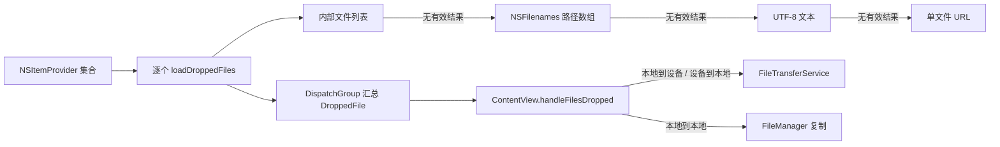
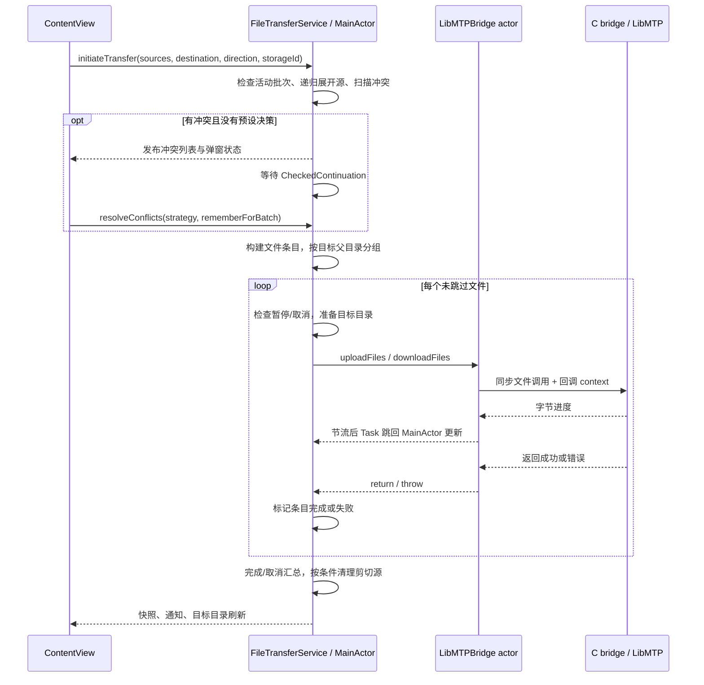

# macMTP 技术架构文档

> 组件清理更新：SentryStub、遥测授权弹窗/开关及空实现更新服务已移除，详见[项目维护记录](../maintenance/2026-10-29-project-refresh.md)。下文相关描述和旧用例保留为整理基线，不再作为当前界面要求。

> 后续修复：本文首次整理基线之后，空目录、剪切源清理、重复提交等问题已在 [8 项缺陷修复与回归报告](../test-reports/2026-10-29-fixes/REPORT.md) 中更新。下文的原实现差异保留作基线记录，当前行为以修复报告及代码为准。

| 项目 | 内容 |
| --- | --- |
| 文档版本 / 日期 | 1.0 / 2026-10-29 |
| 对应基线 | Bundle 1.0.6（build 5）及当前工作区多文件拖放修复 |
| 编写依据 | 当前 Swift、C bridge、Swift Package 与构建脚本源码 |
| 配套文档 | [PRD](../product/PRD.md)、[测试用例](../testing/TEST_CASES.md)、[文档索引](../README.md) |
| 适用读者 | 维护界面、连接、文件操作、传输和打包逻辑的开发及测试人员 |

本文描述当前实现；“演进建议”与“风险”不表示相应改造已经完成。源码中保留的历史名称、低层接口及设备能力声明，不等于当前产品已经开放或完成实机验证的功能。

## 1. 架构概览

macMTP 是单进程原生 macOS 应用。AppKit 管理窗口、菜单和应用生命周期，SwiftUI 组织界面；主线程服务协调设备状态和文件传输；`LibMTPBridge` actor 将 Swift 调用转成 C ABI；C bridge 持有 LibMTP 设备句柄，通过 LibMTP/libusb 与 USB MTP 设备通信。本地文件操作直接使用 Foundation/AppKit。

当前采用视图与共享服务协作的结构，业务逻辑分布在 `ContentView`、`FileExplorerPane`、设备管理及传输服务中，没有统一的独立 ViewModel/Repository 层。视图也会直接调用 bridge 或 FileManager，不能按严格单向依赖或纯 MVVM 理解。



### 1.1 运行边界

- 一个应用进程共享一个 `LibMTPBridge.shared` 和一个 C handle；C 连接当前选择检测结果的第一台设备，不提供多设备会话池。
- 当前 bridge 工厂仅返回 LibMTP；保留的 `mtpEngine` 偏好读取不代表存在多个可切换后端。
- 传输服务管理一个活动批次；按目标父目录分组、每个文件串行调用，不提供并行批次和持久化任务队列。
- `TransferDirection` 只有本地上传和设备下载；设备内复制/移动走设备管理与专门操作进度，不经过该双向传输队列。
- 文件内容走本地文件路径与 LibMTP 文件接口；JSON 用于元数据和结果，不承载文件内容。

## 2. 模块与职责

| 模块 | 主要文件 | 职责与依赖 |
| --- | --- | --- |
| 应用入口 | [main.swift](../../Sources/macmtp/App/main.swift) | `AppDelegate` 创建 NSWindow、NSHostingView、菜单与辅助窗口；启动 USB 监听；语言变化后安排新进程启动并退出当前进程 |
| 页面协调 | [ContentView.swift](../../Sources/macmtp/Views/ContentView.swift) | 单/双栏、活动面板、选择集合、剪贴板路由、确认/冲突弹窗、服务状态订阅及文件操作分流 |
| 文件面板 | [FileExplorerPane.swift](../../Sources/macmtp/Views/FileExplorerPane.swift) | 本地异步列目录、筛选/排序、导航、视图、选择、编辑、拖出/拖入、图片/PDF 缩略图 |
| 辅助视图 | [Views](../../Sources/macmtp/Views) | 工具栏、存储选择、侧边栏、状态栏、传输详情、偏好、关于及帮助；`TransferBatch` 当前也定义在 TransferProgressView 文件中 |
| USB 监听 | [USBWatcher.swift](../../Sources/macmtp/Services/USBWatcher.swift) | IOKit 热插拔注册、初始扫描、延迟/合并连接、MTP 接口及占用判断、拔出后验证 |
| 设备管理 | [MTPDeviceManager.swift](../../Sources/macmtp/MTP/MTPDeviceManager.swift) | 主线程设备状态、连接/断开、能力/存储/目录、导航历史、文件管理、手动解除占用 |
| 传输服务 | [FileTransferService.swift](../../Sources/macmtp/Services/FileTransferService.swift) | 递归展开、冲突扫描/等待、队列、目录准备、进度映射、批次终态、剪切后源清理及通知 |
| 剪贴板 | [ClipboardManager.swift](../../Sources/macmtp/Models/ClipboardManager.swift) | 进程内源条目、源路径、来源端及 copy/cut 操作；界面展示数量和描述 |
| MTP 抽象 | [MTPBridgeProtocol.swift](../../Sources/macmtp/MTP/MTPBridgeProtocol.swift)、[MTPBridgeFactory.swift](../../Sources/macmtp/MTP/MTPBridgeFactory.swift) | 定义异步设备/目录/文件/传输操作；工厂返回 LibMTP 单例 |
| Swift bridge | [LibMTPBridge.swift](../../Sources/macmtp/MTP/LibMTPBridge.swift) | actor 隔离、句柄包装、路径规范化、C 字符串/JSON 转换、错误映射及传输回调适配 |
| C bridge | [libmtp_bridge.h](../../Sources/CLibMTPBridge/include/libmtp_bridge.h)、[libmtp_bridge.c](../../Sources/CLibMTPBridge/libmtp_bridge.c) | C ABI、设备资源、互斥保护、路径到 object ID 解析、LibMTP 调用、JSON 构建及覆盖上传保护 |
| 模型与工具 | [Models](../../Sources/macmtp/Models)、[Utilities](../../Sources/macmtp/Utilities) | 文件/设备/传输模型、兼容响应 DTO、格式化、本地化与错误日志 |
| 构建与验证 | [Package.swift](../../Package.swift)、[scripts](../../scripts)、[Tests](../../Tests/macmtpTests) | Swift/C 编译链接、动态库打包、架构与签名检查、单元测试 |

## 3. 状态归属与数据模型

### 3.1 状态持有者

| 状态 | 持有者 | 生命周期与传播 |
| --- | --- | --- |
| 设备连接、能力、存储、当前 MTP 路径、目录列表 | `@MainActor MTPDeviceManager` | `@Published` 发布；ContentView 用 `.onReceive` 映射为页面状态 |
| 活动面板、两端选择、弹窗、部分目录与容量展示状态 | `ContentView` | SwiftUI 状态/绑定；与服务有镜像状态，维护时需核对订阅更新 |
| 文件显示集合、排序/筛选、加载状态、导航及缩略图 | `FileExplorerPane` 等 | 本地临时状态；异步读取完成后回主线程，更新绑定与显示集合 |
| 活动批次、冲突等待、暂停/取消标记、传输快照 | `@MainActor FileTransferService` | 活动批次包含可观察条目/汇总；轻量 `TransferSnapshot` 供状态栏订阅 |
| C 设备指针、错误缓冲、销毁标记 | `mtp_bridge_handle` | bridge actor 持有包装对象；C handle 自带 mutex |
| 应用剪贴板、近期拖动 payload | `ClipboardManager`、`InAppDragState` | 进程内；近期拖动 payload 默认有效期 30 秒，不构成持久化任务 |
| 缩略图 | `FileThumbnailLoader` 的 `NSCache` | 进程内缓存；不构成设备元数据数据库或磁盘缩略图服务 |

服务中的主线程隔离和页面镜像状态共同构成当前更新机制。修改某个发布字段时，要检查设备栏、状态栏、文件面板与弹窗是否都收到更新；不能只修改视图里的一份副本。

### 3.2 关键模型

| 模型 | 关键内容 | 技术含义 |
| --- | --- | --- |
| `FileNode` | 名称、路径、父路径、目录标记、大小、时间、objectId/parentId | 两端浏览与传输入口的统一描述；MTP 路径不是可直接访问的本地文件路径 |
| `GoDeviceInfoData`、`GoStorageData`、`GoFileInfo` 等 | JSON 对应的 Codable 数据 | `Go` 是保留的兼容命名，当前调用不经过 Go 进程或 Go 运行时 |
| `MTPDeviceCapabilities` | Move/Copy/Partial/Edit 能力位 | 来源为设备/LibMTP；能力位只用于判断可尝试的操作，不代表已提供断点续传或在线编辑产品功能 |
| `DroppedFile` | 路径、来源端、名称、是否目录 | 拖放解析结果，后续由 ContentView 转为 FileNode 并决定方向 |
| `TransferItem` | UUID、源/目标路径、方向、大小、状态、字节、速度、错误 | 单文件结果与进度；文件名不是唯一标识，递归目录可出现相同 basename |
| `TransferBatch` | items、currentItemIndex、state、起始时间与速度样本 | 单活动批次；总量按条目汇总，滑动样本估算总速度/剩余时间 |
| `ConflictingFilePair` | 源/目标路径、大小、时间 | 冲突展示与决策；按大小策略不计算内容哈希 |

`TransferStatus` 的终态是 completed/failed/skipped；`TransferState` 的批次终态是 completed/cancelled/failed。当前 runQueue 对含失败文件的结束批次仍调用 `complete()`，再用失败计数和通知说明结果。因此“批次 completed”不能直接解释为全部文件成功。全零字节批次、全部跳过批次的总百分比也须结合条目状态判断。

## 4. 核心流程

### 4.1 启动、连接与断开



初始连接延迟约 0.5 秒，插入事件约 3 秒；接口尚未出现或被占用时调度后续检查。`pendingConnectTask`/`pendingVerifyTask` 避免相同类任务不断堆积。拔出验证会在管理器正在加载时跳过，所以这是尽力检测流程，不是严格实时的断连状态机。

占用修复是用户触发的独立分支：检查 `ptpcamerad` 等占用，通过 osascript 系统授权执行释放逻辑，再检查接口并尝试重连。普通自动检测不应被描述为自动执行系统授权。修复失败由 `errorMessage` 发布。

### 4.2 列目录与刷新一致性

- 本地面板通过全局 userInitiated 队列读取 URL resource values，回主线程更新；`sizeGen` 将已过期的本地结果挡在 UI 外。
- MTP 目录由设备管理器请求 bridge，转换 `GoFileInfo → FileNode` 后发布；`isRefreshingFiles` 和 `needsRefreshAfterCurrent` 合并刷新请求，generation 和 requestedPath 检查避免旧路径结果覆盖新路径。
- 这些检查不是统一的会话令牌。存储切换和断连期间仍需检查请求携带的 storageId 与当前状态是否一致；现有 generation/path 保护不能直接推断为已覆盖所有跨存储竞争。
- 文件面板在显示层处理隐藏项、名称/扩展名筛选和排序。bridge 的 `walk(...skipHidden:)` 当前转发给 `listDirectory`，未应用 skipHidden 参数；调用者不能依靠该参数隐藏递归内容。
- MTP 路径解析在 C 层逐级枚举子项目、匹配名称并取 item_id；连接使用 `LIBMTP_Open_Raw_Device_Uncached`，没有应用级长期 object ID 索引。深路径和递归扫描可能产生多次设备往返。

### 4.3 拖放与剪贴板路由



每个 provider 采用第一个有效格式；内部列表和普通文本可保留完整多选，而标准 URL 在当前拖出实现中只注册首项。本次修复将完整列表置于 URL 前，并在加载失败/空结果时继续回退。`ThreadSafeArray` 用 NSLock 保护异步结果，`DispatchGroup` 结束后主线程提交一次集合；多个 provider 的回调顺序不构成文件顺序保证。

内部 payload 当前按换行分隔 `local|mtp:file|dir:path`；解析使用冒号最多分成三段，所以路径中冒号可保留，路径中换行仍有歧义。`InAppDragState` 仅在汇总为空时提供近期 payload 兜底，缺少与本次拖动对象的强关联，存在复用旧文件的风险。

剪贴板路径由 ContentView 按来源端/目标端路由：本地同端用 FileManager；跨端进入 FileTransferService；设备同端按能力位进入 move/copy 操作。内部剪贴板为空时，粘贴才尝试读取系统剪贴板文件 URL。设备内移动/复制显示专门进度，不复用上传/下载批次。

MTP 单文件拖出 Finder 使用 NSItemProvider 文件表示：后台任务先下载至临时目录，再把本地 URL 交给接收者。当前只为恰好一个非目录文件注册该表示；临时目录生命周期与实机 Finder 行为仍需单独验收。

### 4.4 传输、冲突与结果提交



具体处理分为以下阶段：

1. `expandSources` 展开本地/设备目录，记录 absolutePath、relativePath、大小和时间；本地递归有深度限制。文件队列过滤掉目录，仅按文件目标准备父目录，因此当前空目录不能完整保留。
2. `scanForConflicts` 对比目标路径和元数据；冲突决策可逐项或应用剩余项，通过 continuation 将 UI 的选择送回异步服务。取消路径要结束等待，避免后续任务一直挂起。
3. `runQueue` 按 destination parent 分组；LibMTP chunkSize 当前为 1。字典分组不保证全局按用户选择顺序执行，产品验收应核对文件集合。
4. 每个文件 bridge 成功返回后才标记完成；进度字节达到文件大小本身不表示文件已经提交。
5. 失败条目标记 failed，服务继续按现有循环处理剩余项；取消由标记控制后续调度。结果通知依赖系统通知授权，应用内状态仍是必要反馈来源。
6. 正常结束后刷新上传目标或发送本地目录刷新通知；结束批次约 3 秒后清理，使用对象身份判断防止清理新批次。

剪切的当前实现会在未取消且没有 failed 条目时删除整组源路径，未排除 skipped 项。它不具备逐文件提交日志或业务事务保证，不能把“没有 failed”视为“所有源都已迁移”。对应风险与验收要求见 PRD G-02。

## 5. Swift/C 边界与文件提交语义

### 5.1 ABI 与内存所有权

| 跨界对象 | 当前约定 | 维护要求 |
| --- | --- | --- |
| `mtp_bridge_handle_t *` | Swift 包装为 OpaquePointer，由 actor 持有；dispose 断开设备，包装对象 deinit 调 destroy | 区分“可再次连接的断开”与“不可再使用的销毁” |
| JSON `char *` | C 分配，Swift `takeString` 转换后调用 `mtp_bridge_free_string` | 新增 JSON 接口须沿用释放约定，不能把它当静态常量 |
| `last_error` 的 `const char *` | 指向 handle 内部错误缓冲，Swift 立即拷贝成 String | 不调用 free；不要跨其他操作长期保留该指针 |
| 路径 `const char *` | Swift 使用 withCString，在同步 C 调用作用域内有效 | C 若将来异步保存路径，必须另行复制并定义释放时机 |
| 文件存在性参数数组 | Swift 用 strdup 构造 C 指针，结束后释放 | 返回与输入按路径对应，避免顺序假设遗漏 |
| 进度 `void *context` | `Unmanaged.passUnretained` 传回调对象，同步文件调用期间由 Swift 局部变量持有 | 当前依赖同步回调生命周期；异步 C API 不能直接照搬 |

C handle 的 destroy 当前释放底层 device 并标记 destroyed，但有意保留小型 handle/mutex，避免并发调用者或错误指针访问已释放内存；源码说明这是进程生命周期中的小对象保留。它不能被描述为完整释放全部 C 堆内存，也不能按每任务 create/destroy 的模式无限复用。

C 头文件还暴露了格式化、partial I/O、对象属性、媒体等更底层接口，其中不少并未接入 MTPBridgeProtocol 或产品 UI。扩展功能前应沿“头文件 → Swift 包装 → 服务规则 → UI → 测试”确认完整链路，不能仅据 C 函数存在就宣称产品支持。

### 5.2 上传与覆盖保护

`mtp_bridge_upload_file` 检查本地普通文件、解析目标目录和已有同名对象。无同名目标时直接以原名上传；目标是目录时拒绝文件覆盖。已有同名文件时执行：

1. 上传新内容至唯一临时对象名，不先删除旧文件。
2. 上传成功后解析临时 object ID，生成备份名。
3. 把旧目标改为备份名，再把新对象改为最终名称。
4. 新对象发布成功后删除备份；若只是备份清理失败，输出 stderr 诊断，返回已提交成功。
5. 发布前失败会尝试清理临时对象；新对象改名失败会尝试恢复旧名称，保留原始错误信息。

这是按设备对象操作实现的补偿流程，跨多个 MTP 命令，不是设备端原子事务。断电、掉线、设备不支持改名或清理失败时可能残留临时/备份对象。覆盖期间可能同时占用旧文件与新文件的空间，不能仅按新旧大小差估算可用容量。

### 5.3 下载提交

Swift bridge 将数据下载到目标同目录的 `.<name>.macmtp-<UUID>.partial` 文件；LibMTP 返回成功后通过 Darwin `rename` 发布到最终目标。正常返回或抛错离开作用域会尝试删除 partial。这样可以避免下载中途直接破坏已有目标，并让最终替换留在同一文件系统内。

进程被强制终止时 defer 不保证执行；目录权限、磁盘空间与 rename 失败需要单独报告。该流程未增加内容哈希校验，也不支持对 partial 继续写入实现断点续传。

## 6. 并发、回调与一致性

| 边界 | 隔离/同步方式 | 实际保证与限制 |
| --- | --- | --- |
| UI、连接状态、传输服务、剪贴板 | MainActor / SwiftUI 主线程状态 | 状态变更集中到主线程；同步本地扫描/文件操作仍可能占用 UI，不能因用了 Task 就认定已移到后台 |
| Swift MTP 访问 | `LibMTPBridge` actor | 串行进入 actor 的隔离代码；await 处允许交错，多个方法组合不是事务 |
| 原生设备访问 | handle 内 `pthread_mutex_t` | 保护单次 C 操作和设备指针；文件传输同步持锁，其他设备请求可能等待 |
| 本地列目录、部分目录大小/缩略图工作 | DispatchQueue / Task | 返回 UI 前检查有效性或回主线程；局部后台化不构成全局 I/O 调度器 |
| 拖放加载与缓存 | DispatchGroup、NSLock | 安全收集异步结果/近期 payload；锁不保证 payload 属于本次拖动 |
| 传输回调 | 同步 C 回调 → Sendable closure → Task MainActor | 避免直接从 C 回调修改 UI；不在持锁回调内再次同步调用相同 handle，防止重入死锁 |

actor 不是专用阻塞 I/O 线程：同步 LibMTP 调用会占用执行它的线程，并在返回前阻止同一 actor 处理其他消息。文件传输期间的目录请求、断连或校验可能等待底层调用结束。若需要更严格的响应隔离，应另设计专用串行 I/O 执行器和取消协议，当前没有该层。

进度处理采用以下保护：

- `LibMTPTransferProgressMapper` 按预期文件大小钳制 sent，避免协议传输额外字节把进度推过 100%；单文件速度先按 MiB/s 计算，服务换算为 bytes/s。
- `TransferProgressThrottle` 对 LibMTP 按约 0.15 秒间隔发布，完成字节回调可直通；MainActor 不必处理底层每一个回调。
- 服务检查 expectedBatchID，旧批次回调不能修改新批次；按源/目标完整路径优先匹配条目，之后才回退文件名与当前索引。
- 已终态条目忽略进度，完成以 bridge 返回成功为准；同 basename 的回退仍有歧义，应优先维护路径正确性。
- 暂停/取消检查位于队列文件边界，C 回调没有接入可中断的取消令牌；任务取消不等于当前 USB 文件调用已经停止。

## 7. 配置、文件与系统集成

### 7.1 持久化与临时资源

| 位置/键 | 数据 | 说明 |
| --- | --- | --- |
| UserDefaults `explorerLayoutMode` / `swapPanels` | 单/双栏、面板交换 | 默认双栏、不交换 |
| `showHiddenFilesLocal` / `showHiddenFilesMTP` | 两端隐藏文件显示 | 默认关闭，独立存储 |
| `autoDetectDevice` | USB 自动连接开关 | 默认开启，USB 事件处理读取 |
| `appFontScale` / `appLanguage` | 字体比例、system/en/zh-Hans | 默认 1.0 与 system |
| `hasSeenPrivacyPrompt` / `sendCrashReports` | 首次提示与日志上报选择 | 上报默认值在不同入口不完全一致，不能推断出统一首次默认 |
| `mtpEngine` | 历史后端键 | 当前枚举只有 libmtp，工厂始终返回同一 bridge |
| NSWindow frame autosave | 主窗口位置与尺寸 | 由 AppKit 管理 |
| 临时目录 / 目标同目录 | Finder 拖出下载文件、下载 partial | 不属于持久化队列；清理语义见相应流程 |
| `/tmp/macmtp-debug.log` | 连接、操作、路径和错误日志 | 串行 utility 队列追加；当前没有应用级日志轮转 |

当前没有数据库、账号数据、任务恢复文件或统一事务日志。应用退出后，剪贴板、拖动缓存及活动传输状态均不作为恢复依据。

### 7.2 本地化、通知与遥测

`L10n` 根据 appLanguage 选择 `.lproj` bundle，并提供 `t`/`f` 动态字符串入口；`LocalizedRootView` 设置 SwiftUI locale。语言变更通过 NotificationCenter 送至 AppDelegate，重启以统一 AppKit 菜单和 SwiftUI 文案。重启保护活动任务的规则仍需验收。

文件刷新与菜单操作也使用进程内 NotificationCenter，例如 `localDirectoryNeedsRefresh`、`menuNewFolderRequested`。系统通知通过 UNUserNotificationCenter 申请授权和发送，用户拒绝时不应影响文件传输。

Package.swift 的 Sentry target 实际指向本地 `Sources/SentryStub`；start 仅运行配置闭包，capture 为空。当前没有由这个 stub 发出的遥测上传，隐私开关也不控制所有本地 debug 日志。UpdaterService 文件仍保留，但当前菜单/偏好和启动流程未开放更新检查，不能把它画成正在运行的后台更新服务。

## 8. 构建、依赖与发布

### 8.1 编译依赖

Swift Package 使用 tools version 6.0、声明 macOS 14，包含 `CLibMTPBridge`、本地 `Sentry`、可执行 target `macmtp` 和 `macmtpTests`，没有远程 Swift Package 依赖。

C target 依赖同级 LibMTP 1.1.23 的头文件和构建产物，链接 LibMTP、libusb、libgcrypt、libgpg-error、iconv 及系统框架。`GoResponseModels.swift` 只是 Swift 模型文件；Info.plist 中遗留的 GODEBUG/GOTRACEBACK 不代表当前有 Go 后端。

| 环境变量 | 用途 |
| --- | --- |
| `MACMTP_LIBMTP_ROOT` | LibMTP 根目录，默认仓库同级 `libmtp-1.1.23` |
| `MACMTP_LIBMTP_LIB_DIR` | LibMTP 动态/静态库搜索目录，默认 root/src/.libs |
| `MACMTP_LIBUSB_LIB_DIR` | Package 链接时 libusb 搜索目录 |
| `MACMTP_ARM64_LIBUSB_PKGCONFIG` / `MACMTP_X86_64_LIBUSB_PKGCONFIG` | build.sh 按架构定位 libusb pkg-config |

Package 中仍有部分 `/opt/homebrew` 固定搜索路径，不能仅设置一个变量就假定所有依赖自动适配任意架构；Intel/universal 需要实际对应的依赖和构建验证。

### 8.2 打包链路

推荐用 `scripts/build.sh`：按架构构建 → 创建根目录 macMTP.app → 复制 Info.plist、图标和语言资源 → 打包运行库 → 重写 install names → 签名并校验。主要运行库位于 `Contents/MacOS`，使用 `@executable_path` 引用，包括 libusb、libmtp、libgcrypt、libgpg-error 和 libintl。

release 模式检查运行库最低 macOS 版本不高于 14.0；universal 需主程序与所有运行库均包含 arm64/x86_64。声明最低系统版本、主程序编译成功或签名通过，都不等于运行库已兼容 macOS 14。

`scripts/release.sh` 调用构建，设置包版本、重新签名，生成架构对应 DMG/ZIP、校验文件和更新元数据；脚本会重建 release 输出目录，执行前应确认已有发布产物已归档。当前自动更新 UI 隐藏，生成元数据不代表客户端会自动检查。

`scripts/package.sh` 是较简化的旧打包入口，只构建/复制主程序和基础资源，不等同于 build.sh 的完整运行库与本地化处理；发布验收以完整构建链路为准。

```bash
# 从仓库根目录构建当前架构的 debug 应用
MACMTP_LIBMTP_ROOT="$PWD/../libmtp-1.1.23" \
  bash scripts/build.sh debug --arch "$(uname -m)"

# 核对打包结果
codesign --verify --deep --strict macMTP.app
otool -L macMTP.app/Contents/MacOS/macMTP
lipo -archs macMTP.app/Contents/MacOS/macMTP
```

## 9. 错误处理与诊断路径

C bridge 将 LibMTP error stack 聚合到 handle 错误缓冲并清理原 stack；Swift 将空指针、非零状态、缺失 JSON data 或解码失败转为错误。`MTPBridgeError` 提供设备、操作、传输、响应、忙和超时等错误类型，但定义 timedOut 不代表所有底层调用已有统一超时控制。

| 现象 | 优先定位 | 核对点 |
| --- | --- | --- |
| 找不到设备/持续等待 | USBWatcher → MTPDeviceManager → C connect | MTP 模式、IOKit 接口、占用者、自动检测开关、是否打开第一台设备 |
| 多选只传首项 | dragProvider → loadDroppedFiles → handleFilesDropped | 源选择数、provider 类型、解析后文件数、目标路径；不能仅看 providers.count |
| 文件显示完成但内容不对 | runQueue → Swift bridge 返回 → C 提交流程 | 是否仅达到字节进度、是否改名成功、源/目标路径与回读哈希 |
| 进度串文件/跳回传输 | progress batch ID / path matching | 迟到回调、同 basename、终态保护和新批次身份 |
| 覆盖后残留临时文件 | C 上传补偿 / Swift 下载 partial | 失败阶段、备份改名与清理、进程是否强制退出；C stderr 也需保留 |
| 测试 bundle 加载失败 | 动态库 install name / 测试进程搜索路径 | libmtp 构建时绝对路径是否失效；参考测试用例中的直接 xctest 诊断入口 |
| 开发机可运行、其他机器失败 | build.sh / dylib 架构与最低系统版本 | 是否错误使用简化 package.sh、遗漏运行库或仍引用 Homebrew 路径 |

部分文件管理分支使用 `try?` 或仅记录日志，当前并非所有异常都有统一 UI 错误出口。诊断时需同时查看界面、`/tmp/macmtp-debug.log`、必要的标准错误输出和实际文件结果。

## 10. 测试边界与演进建议

现有单元测试覆盖路径规范化、模型解码、工厂/协议、进度钳制、条目终态和拖放 provider 解析。它们不验证 USB 设备行为、系统授权、Finder、覆盖补偿或真机断连；业务/发布矩阵见 [测试用例](../testing/TEST_CASES.md)。本文为源码架构整理，未新增或执行设备测试。

| 顺序 | 建议 | 对应当前问题与验证 |
| --- | --- | --- |
| 1 | 将剪切提交细化为每个源的迁移结果，空目录也纳入队列 | 先解决 G-01/G-02；验证 skipped、failed、cancelled 与空目录不误删源 |
| 2 | 引入设备会话/存储/批次一致性标识，统一忙状态与操作仲裁 | 解决重复提交干扰、跨存储剪贴板、刷新与传输竞争；actor/mutex 不能替代业务互斥 |
| 3 | 把本地/跨端操作与冲突策略从 ContentView 收敛到可测试服务 | 统一入口错误展示和大小策略；通过协议注入受控测试 bridge，减少对单例的硬依赖 |
| 4 | 拖动 payload 改用结构化数据，并关联一次拖动会话 | 消除换行路径歧义和历史缓存误用；保留系统格式兼容和完整多选回归 |
| 5 | 根据设备支持设计可中断传输和独立 I/O 执行边界 | 明确取消完成时点，不把 Task.cancel 当底层取消；补充超时与断连恢复测试 |
| 6 | 收敛配置默认值、增加临时文件/日志清理与可观测性 | 避免隐私默认分歧、拖出临时目录及日志无限增长；保留足够诊断信息 |
| 7 | 固化依赖与架构发布验证，评估收窄未使用的 C API | 最低系统、两架构与干净机回归；保证 ABI 所有权和生命周期约定可维护 |

以上是后续技术方向，不改变本次文档对应的当前运行结构。产品优先级、数据完整性准入和测试判定分别以 PRD、测试用例为准。
